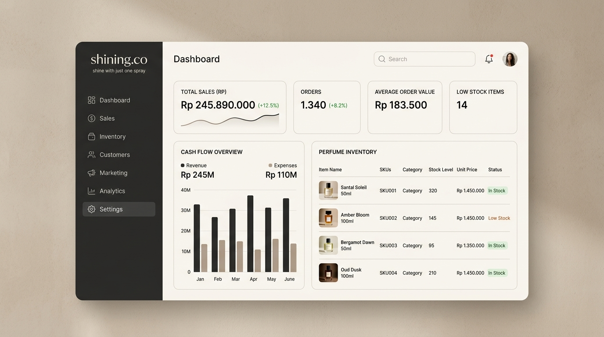

# shining.co Business & Cashflow Tracker
> *"shine with just one spray"*



Aplikasi manajemen bisnis, pencatatan keuangan modern, dan pelacakan arus kas (*cashflow tracker*) real-time yang dirancang khusus untuk operasional brand parfum artisanal **shining.co**.

Dibangun dengan standar rekayasa perangkat lunak enterprise dan estetika visual minimalis, hangat, dan mewah (terinspirasi dari rumah parfum internasional seperti *Aesop*, *Byredo*, dan *Le Labo*). Aplikasi ini memberikan visibilitas penuh terhadap kesehatan finansial, persediaan stok botol, margin laba kotor & bersih, serta riwayat audit mutasi barang secara akurat tanpa pencatatan ganda.

---

## 👨‍💻 Profil Pengembang (Developer Profile)

- **Nama Pengembang**: **RioProjectX**
- **Peran**: Full-Stack Engineer, UI/UX Designer & Database Architect
- **Kontak / Email**: `projectokeyz@gmail.com`
- **Lisensi Proyek**: Proprietary for **shining.co**
- **Visi**: Menghadirkan solusi digital mandiri yang tangguh, elegan, dan presisi untuk mendukung ekspansi bisnis parfum dari UMKM menuju brand artisanal terdepan.

---

## 📖 Latar Belakang & Masalah yang Diselesaikan

Banyak pelaku bisnis parfum mandiri mengalami kesulitan mengukur keuntungan riil karena:
1. **Pencampuran Modal dan Omzet**: Dana setoran modal pemilik sering disalahartikan sebagai pemasukan penjualan.
2. **Pencatatan Ganda Stok**: Pembelian bahan parfum sering dihitung sekaligus sebagai biaya tunai dan biaya HPP, membuat laporan laba rugi menjadi bias.
3. **Selisih Stok Fisik**: Stok berkurang karena tester bazar atau botol pecah tanpa adanya alasan pencatatan yang wajib.
4. **Piutang Macet**: Penjualan yang belum lunas langsung dianggap sebagai kas riil di tangan.

**shining.co Business Tracker** memecahkan masalah ini dengan sistem akuntansi murni yang memisahkan **Kas Riil**, **Piutang Usaha**, **Modal Disetor**, dan **Nilai Persediaan**.

---

## 🌟 Fitur Utama & Fungsionalitas

### 1. Dashboard Eksekutif Real-Time
- **6 Kartu Statistik Kunci**:
  1. **Modal Usaha**: Akumulasi modal awal dan tambahan modal yang disetor.
  2. **Kas Masuk (Pemasukan)**: Uang riil yang benar-benar telah diterima dari penjualan & sumber lainnya.
  3. **Total Pengeluaran**: Pengeluaran operasional, bahan kemasan, promosi, dan pembelian stok.
  4. **Saldo Kas Riil**: Saldo kas riil di rekening/dompet usaha (*Inflow - Outflow*).
  5. **Nilai Persediaan Stok**: Jumlah unit parfum tersedia dikalikan harga modal pokok per botol.
  6. **Estimasi Laba Bersih**: Laba kotor dikurangi beban operasional berjalan.
- **Grafik Tren Arus Kas 7 Hari**: Perbandingan kas masuk dari penjualan vs pengeluaran harian.
- **Peringatan Stok Menipis Otomatis**: Banner notifikasi varian parfum yang mendekati batas minimum.
- **Filter Waktu Dinamis**: Hari Ini, 7 Hari Terakhir, Bulan Ini, dan Semua Periode.

### 2. Manajemen Stok Parfum (Inventory)
- **Data Spesifikasi Produk**: Nama varian, kode SKU, karakter aroma (*Woody, Floral, Amber, dll.*), ukuran botol (ml), harga modal pokok, dan harga jual satuan.
- **Kalkulasi Margin Otomatis**: Menampilkan persentase margin keuntungan per botol.
- **Restock Cepat**: Menambah stok masuk dengan opsi mencatat otomatis ke pengeluaran kas kategori *"Pembelian stok parfum"*.
- **Koreksi Stok Fisik**: Penyesuaian stok dengan kewajiban mengisi alasan (tester, botol pecah, dsb).
- **Audit Trail Pergerakan Stok**: Riwayat pergerakan permanen (*in, out, adjustment, return*) yang tidak dapat dihapus atau dimanipulasi.

### 3. Pencatatan Penjualan & Faktur
- **Pengurangan Stok Atomik**: Menggunakan Firestore Transaction (`runTransaction`) sehingga stok langsung berkurang secara konsisten dan aman dari *race condition*.
- **Metode Pembayaran Fleksibel**: Transfer Bank, QRIS, Tunai, dan E-Wallet.
- **Status Pembayaran**: Lunas, Belum Lunas (Piutang), atau Dibayar Sebagian (Cicilan).
- **Pelunasan Cicilan Lanjutan**: Pencatatan pembayaran piutang bertahap tanpa pengurangan stok ganda.
- **Pembatalan / Retur Transaksi**: Mengembalikan stok botol ke persediaan secara otomatis dan mencatat log pembatalan.
- **Cetak Nota Penjualan Resmi**: Faktur profesional siap cetak langsung atau disimpan sebagai PDF.

### 4. Biaya & Pengeluaran Usaha
- **9 Kategori Pengeluaran**:
  - Botol dan packaging
  - Label dan stiker
  - Pembelian stok parfum
  - Pengiriman / ekspedisi
  - Promosi dan iklan
  - Operasional usaha
  - Transportasi
  - Biaya platform / administrasi
  - Pengeluaran lain
- Analisis alokasi biaya per kategori untuk efisiensi pengeluaran.

### 5. Pemasukan Lainnya (Non-Penjualan)
- Pencatatan cashback pembelian supplier, pengembalian dana ekspedisi, atau komisi non-penjualan.

### 6. Laporan Keuangan Komprehensif & Ekspor Data
- **Laporan Laba Rugi (Income Statement)**: Penjualan Bruto, Diskon, Penjualan Bersih, HPP, Laba Kotor, Margin Kotor (%), Biaya Operasional, dan Laba Bersih.
- **Laporan Arus Kas (Cashflow Statement)**: Arus kas masuk (penjualan, modal, cashback), arus kas keluar, dan saldo akhir kas.
- **Performa Penjualan per Varian**: Peringkat parfum terlaris (*best-seller*) dan kontribusi keuntungan.
- **Ekspor CSV**: Unduh data Penjualan, Stok Persediaan, dan Pengeluaran ke format CSV/Excel dengan satu klik.

---

## 🔒 Keamanan Database (Security Architecture)

Aplikasi ini mengimplementasikan aturan keamanan **Cloud Firestore Security Rules** tingkat lanjut:
- **Default Deny**: Seluruh rute database tertutup secara bawaan (`allow read, write: if false`).
- **Isolasi Multi-Tenant**: Akses data dikunci ketat per pengguna terautentikasi (`resource.data.ownerUid == request.auth.uid`).
- **Anti-Scraping pada List Query**: Query wajib menyertakan filter `where('ownerUid', '==', uid)` dan dievaluasi di level aturan server.
- **Validasi Nilai & Batas Data**: Nominal uang harus non-negatif, teks dibatasi panjangnya untuk mencegah serangan *Denial-of-Wallet*.
- **Immutabilitas Audit Trail**: Dokumen di koleksi `inventoryMovements` tidak dapat diedit atau dihapus.

---

## 💻 Teknologi yang Digunakan

| Komponen | Teknologi |
|---|---|
| **Framework Frontend** | React 19 (TypeScript) |
| **Build Tool** | Vite 8 |
| **Styling** | Tailwind CSS v4 |
| **Tipografi** | Playfair Display & Plus Jakarta Sans |
| **Database Utama** | Google Cloud Firestore (Modular SDK v11) |
| **Autentikasi** | Firebase Authentication (Email/Password & Google OAuth) |
| **Ikon UI** | Lucide React |
| **Animasi & Interaksi** | Motion & Canvas Confetti |

---

## 🚀 Panduan Instalasi & Menjalankan Lokal

### 1. Kloning Repositori & Pasang Dependensi
```bash
git clone <repository-url>
cd shining-co-tracker
npm install
```

### 2. Konfigurasi Environment Variables
Salin file `.env.example` menjadi `.env`:
```bash
cp .env.example .env
```
Isi konfigurasi Firebase Anda pada file `.env`:
```env
VITE_FIREBASE_API_KEY="AIzaSy..."
VITE_FIREBASE_AUTH_DOMAIN="project-id.firebaseapp.com"
VITE_FIREBASE_PROJECT_ID="project-id"
VITE_FIREBASE_STORAGE_BUCKET="project-id.firebasestorage.app"
VITE_FIREBASE_MESSAGING_SENDER_ID="161185499873"
VITE_FIREBASE_APP_ID="1:161185499873:web:..."
VITE_FIREBASE_FIRESTORE_DATABASE_ID="(default)"
```

### 3. Menjalankan Server Lokal
```bash
npm run dev
```
Buka browser di `http://localhost:3000`.

---

## ⚙️ Panduan Pengaturan di Firebase Console

1. **Aktifkan Authentication**:
   - Buka Firebase Console > **Authentication** > **Sign-in method**.
   - Aktifkan provider **Email/Password** dan **Google**.
2. **Buat Firestore Database**:
   - Buka menu **Firestore Database** > **Create database**.
   - Pilih region server (contoh: `asia-southeast2` Jakarta atau `asia-east1`).
   - Pilih opsi **Production mode**.
3. **Terapkan Security Rules**:
   - Buka tab **Rules** pada Firestore Database di Firebase Console.
   - Salin dan tempelkan kode dari file `firestore.rules` pada repositori ini, lalu klik **Publish**.

---

## 📊 Rumus Perhitungan Keuangan

Aplikasi ini menggunakan standar akuntansi bisnis persediaan:
- **Laba Kotor** = `Penjualan Bersih - Harga Pokok Penjualan (HPP)`
- **Laba Bersih** = `Laba Kotor - Biaya Operasional`
- **Saldo Kas Riil** = `(Modal Awal & Tambahan + Kas Diterima dari Penjualan + Pemasukan Lain) - Total Pengeluaran Kas`
- **Nilai Persediaan** = `Jumlah Botol Tersedia × Harga Modal Pokok per Botol`

---

*Dikembangkan dengan penuh dedikasi oleh **RioProjectX** untuk **shining.co**.*
